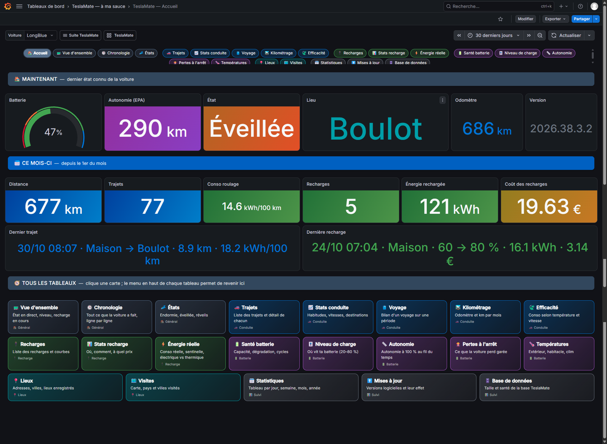
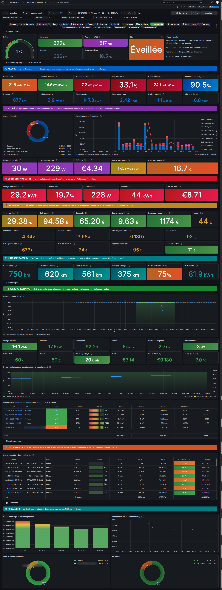
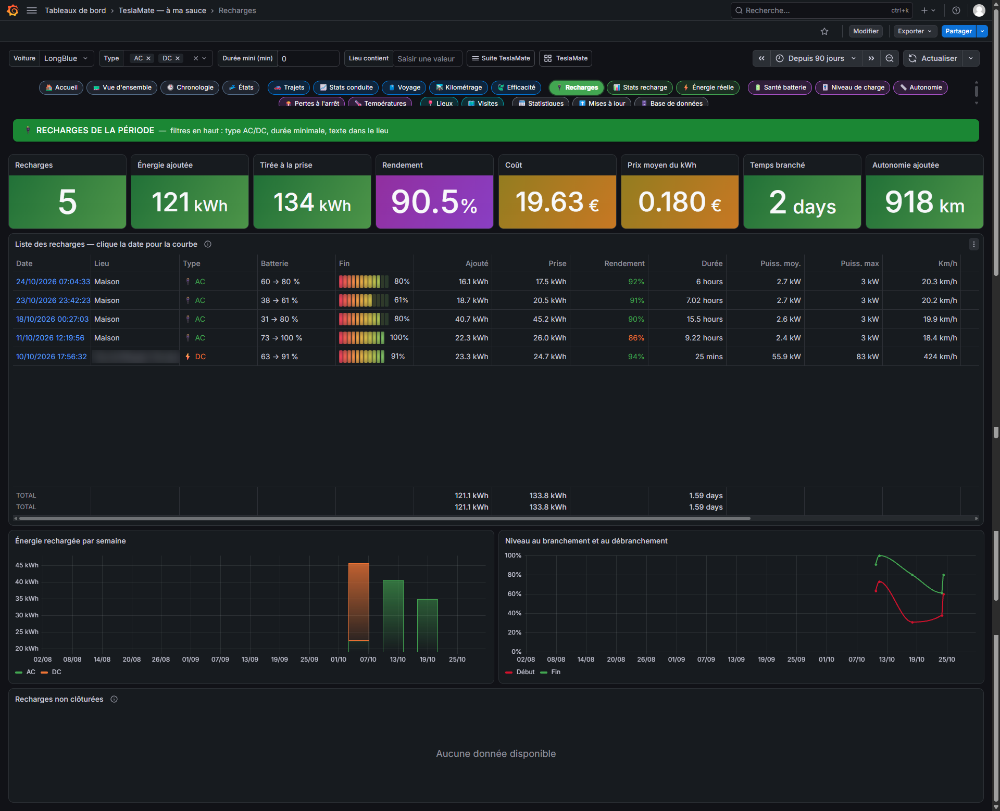
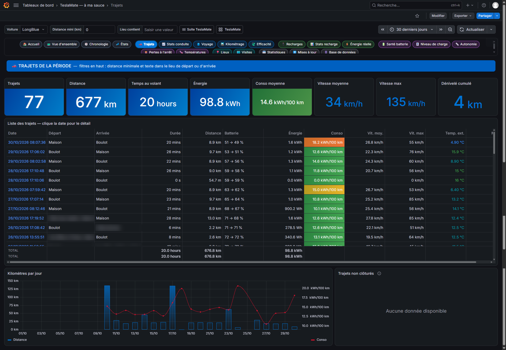
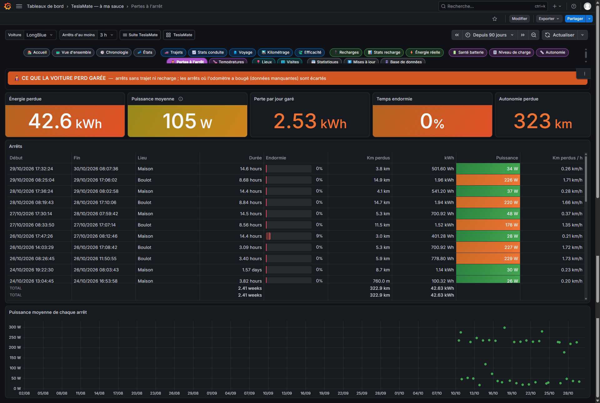

# ⚡ TeslaMate « à ma sauce »

**24 tableaux de bord Grafana en français pour [TeslaMate](https://github.com/teslamate-org/teslamate)**, reliés par un menu commun.
Ils reprennent tout ce que font les tableaux d'origine, et y ajoutent la **consommation réelle** (sentinelle, veille et clim à l'arrêt compris),
la **comparaison avec une voiture thermique** et une navigation pensée pour un usage quotidien.



---

## ✨ Points forts

- 🇫🇷 **Tout en français** : consommations en **kWh/100 km**, montants en **euros complets**, raccourcis de période (« le mois dernier », « les 6 derniers mois »…)
- 🧭 **Menu commun** en haut de chaque page, et une page d'**Accueil** avec une carte « Ma voiture » (état, batterie, températures, lieu…) et les chiffres du mois
- 🗺️ **Cartes soignées** : fond sombre, trajets fléchés colorés selon la vitesse, carte de chaleur de tes routes. Aucun plugin à installer
- 🖱️ **Tout est cliquable** : un trajet ou une recharge ouvre son détail ; un lieu se transforme en geofence en un clic
- ⚡ **Énergie réelle** : toute l'énergie sortie de la batterie, sur les X derniers km ou sur une période, avec le coût de la **sentinelle** isolé
- ⛽ **Électrique vs thermique** : économie calculée avec tes vrais prix de recharge, face à la voiture essence de ton choix
- 🎨 Sections colorées, valeurs **mesurées** séparées des **estimations**
- 🚗 La voiture la plus récente est sélectionnée automatiquement, pratique si tu as changé de Tesla

## 📸 Aperçu

| Énergie réelle & recharges | Recharges |
|---|---|
|  |  |
| **Trajets** | **Pertes à l'arrêt** |
|  |  |

## 📚 Les tableaux

| | Tableau | Ce qu'il montre |
|---|---|---|
| 🏠 | **Accueil** | Carte « Ma voiture », chiffres du mois, accès à tous les tableaux |
| 📟 | **Vue d'ensemble** | Direct : batterie, recharge en cours, températures, activité |
| 🕒 | **Chronologie** | Conduite, recharges, stationnements, mises à jour, trous de données |
| 💤 | **États** | Endormie / éveillée, réveils par jour |
| 🚗 | **Trajets** + **Détail d'un trajet** | Liste filtrable ; carte, vitesse, puissance, altitude, pneus |
| 📈 | **Stats de conduite** | Vitesses, heures, jours, destinations |
| 🧳 | **Voyage** | Bilan d'un voyage sur la période choisie |
| 🛣️ | **Kilométrage** | Odomètre, km par mois, km non enregistrés |
| 🍃 | **Efficacité** | Conso selon la température, la vitesse, la saison |
| 🔌 | **Recharges** + **Détail d'une recharge** | Liste filtrable ; courbe comparée à tes autres recharges |
| 📊 | **Stats de recharge** | Lieux, AC/DC, niveaux de branchement, coûts, courbes DC |
| ⚡ | **Énergie réelle & recharges** | Conso réelle, sentinelle, autonomie WLTP / EPA / réelle, électrique vs thermique |
| 🔋 | **Santé de la batterie** | Capacité utile, dégradation, cycles |
| 🎚️ | **Niveau de charge** | Temps passé entre 20 et 80 % |
| 📏 | **Autonomie projetée** | Autonomie à 100 % au fil du temps, mises à jour en repère |
| 🧛 | **Pertes à l'arrêt** | Ce que la voiture perd garée, arrêt par arrêt |
| 🌡️ | **Températures** | Extérieur, habitacle, clim voiture garée |
| 📍 | **Lieux** | Où tu passes du temps |
| 🗺️ | **Visites** | Carte de chaleur de tes routes, pays (avec drapeaux) et villes |
| 🗓️ | **Statistiques** | Récapitulatif par jour, semaine, mois ou année |
| ⬆️ | **Mises à jour** | Versions logicielles, autonomie et conso pendant chacune |
| 🗄️ | **Base de données** | Taille, tables, index, régularité de l'enregistrement |

## 🔧 Installation

**Prérequis** : TeslaMate avec son Grafana, la source de données d'origine (identifiant `TeslaMate`), et des réglages en **km** et en **°C**.

Tout s'installe dans un dossier Grafana à part, **« TeslaMate — à ma sauce »**. Les tableaux d'origine ne sont pas touchés.

### Automatique (recommandé)

1. Télécharge la dernière version dans **[Releases](../../releases)**, ou le dépôt complet (**Code → Download ZIP**), puis dézippe-la.
2. Dans Grafana : **Administration → Comptes de service → Ajouter** (rôle **Éditeur**), puis **Ajouter un jeton**.
3. Lance l'import depuis le dossier dézippé :

**Windows (PowerShell)**
```powershell
powershell -ExecutionPolicy Bypass -File .\importer.ps1 -Url http://IP-DU-GRAFANA:3000 -Jeton glsa_xxxxxxxx
```

**Linux / Unraid / macOS**
```sh
sh importer.sh http://IP-DU-GRAFANA:3000 glsa_xxxxxxxx
```

Si ta source de données n'a pas l'identifiant `TeslaMate`, ajoute le sien à la fin de la commande (`-SourceUid MonUID` sous Windows).

4. Ouvre `http://IP-DU-GRAFANA:3000/d/tms-accueil`, puis désactive le jeton.

**Docker**

Si vous avez installé Teslamate avec docker comme indiqué (dans leur documentation)[https://docs.teslamate.org/docs/installation/docker], vous pouvez integrer directement ces dashboard facilement

Récuperer le `Zip` ou fait un `Git clone` du projet au meme endroit que votre `docker-compose.yml` de teslamate

Dans la suite, je pars du principe que vous avez mis le dossier `tesla-a-ma-sauce/` au meme niveau de votre `docker-compose.yml` et que le repertoire de travail est `/home/rpi`

Ajouter dans votre `docker-compose.yml` au niveau du service grafana

`sudo nano docker-compose.yml`

```yml
...
  grafana:
    ...
    volumes:
      - teslamate-grafana-data:/var/lib/grafana
      # Ligne à rajouter pour les DashBoard Tesla-a-ma-sauce
      - /home/rpi/teslamate-a-ma-sauce/teslamate-a-ma-sauce.yml:/etc/grafana/provisioning/dashboards/teslamate-a-ma-sauce.yml
      - /home/rpi/teslamate-a-ma-sauce/dashboards:/teslamate-a-ma-sauce
    
...
```

Relancer la partie grafana de TeslaMate

`sudo docker compose -f docker-compose.yml up -d`


### Manuelle

Grafana → **Tableaux de bord → Nouveau → Importer**, puis importe chaque fichier du dossier `dashboards/` dans le même dossier.

### Mise à jour

Relance la même commande avec la nouvelle version : les tableaux sont remplacés à leur place, sans doublons.

## ⚙️ Réglages utiles

- **Énergie réelle** :
  - **Analyser** : les X derniers km, ou la période choisie en haut à droite.
  - **Parking boulot** : le geofence où tu laisses tourner la sentinelle. Il faut l'avoir créé dans TeslaMate.
  - **Thermique (L/100 km)** et **Carburant (€/L)** : la voiture essence de référence.
  - **WLTP fiche (km)** : l'autonomie annoncée par Tesla pour ta version.
- **Coûts** : renseigne le prix du kWh sur tes geofences dans TeslaMate (maison, Superchargeur…). Les recharges sans coût sont comptées au « prix kWh de secours ».
- **Page d'accueil Grafana** : *Administration → Préférences par défaut → Tableau de bord d'accueil* → **TeslaMate — Accueil**.

## ❓ Bon à savoir

- **EPA ou WLTP ?** Même en Europe, l'autonomie affichée par une Tesla est calculée sur une base EPA, plus basse que le WLTP de la fiche. Le tableau Énergie réelle affiche les deux, plus ton autonomie réelle.
- **Comment est mesurée l'énergie ?** Par l'autonomie perdue × le coefficient de consommation que TeslaMate déduit de tes recharges. C'est fiable à quelques pour cent, mais ce n'est pas un compteur.
- **Superchargeurs** : TeslaMate ne connaît souvent que l'énergie entrée dans la batterie, donc les pertes en DC ne sont pas comptées.
- Le rapport fiscal néerlandais des tableaux d'origine n'est pas repris.

## 🙏 Crédits

Construit sur l'excellent projet [TeslaMate](https://github.com/teslamate-org/teslamate) et sur ses tableaux de bord d'origine, dont certaines requêtes ont servi de base.
Projet indépendant, sans lien avec Tesla ni TeslaMate.

Retours, bugs et idées bienvenus dans les [Issues](../../issues) !

## 📄 Licence

[AGPL-3.0](LICENSE), comme TeslaMate et ses tableaux de bord d'origine dont ce projet s'inspire.
